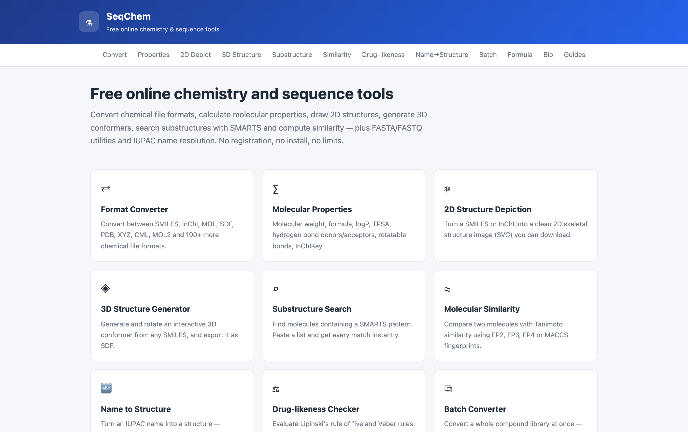
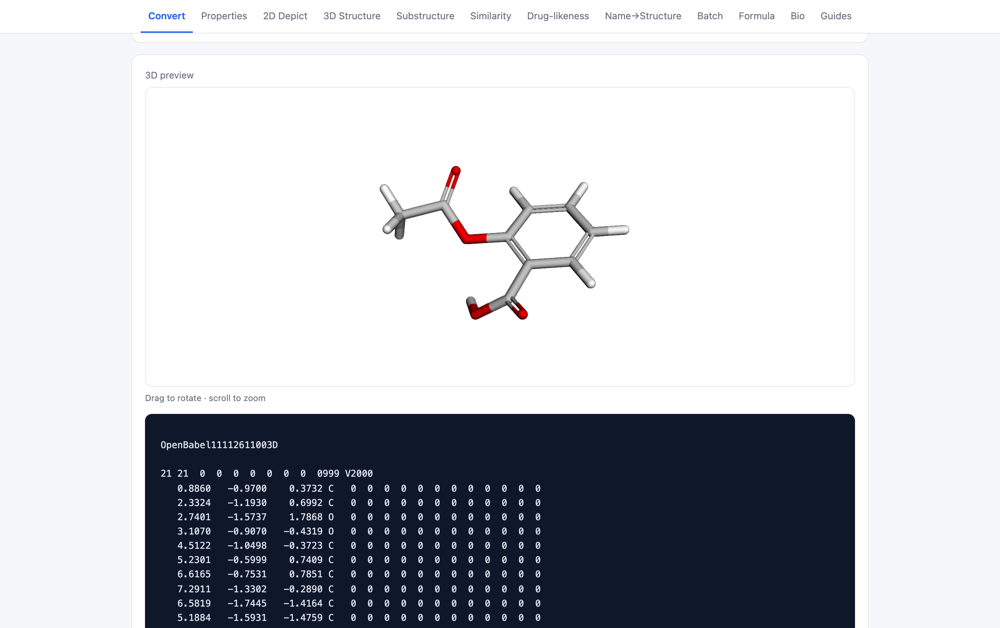
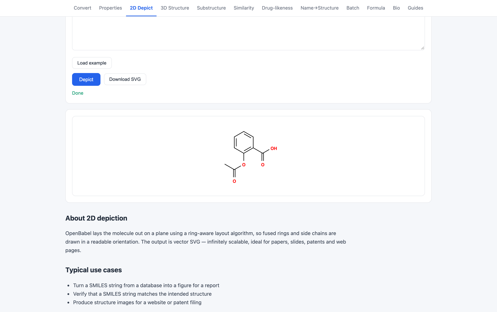
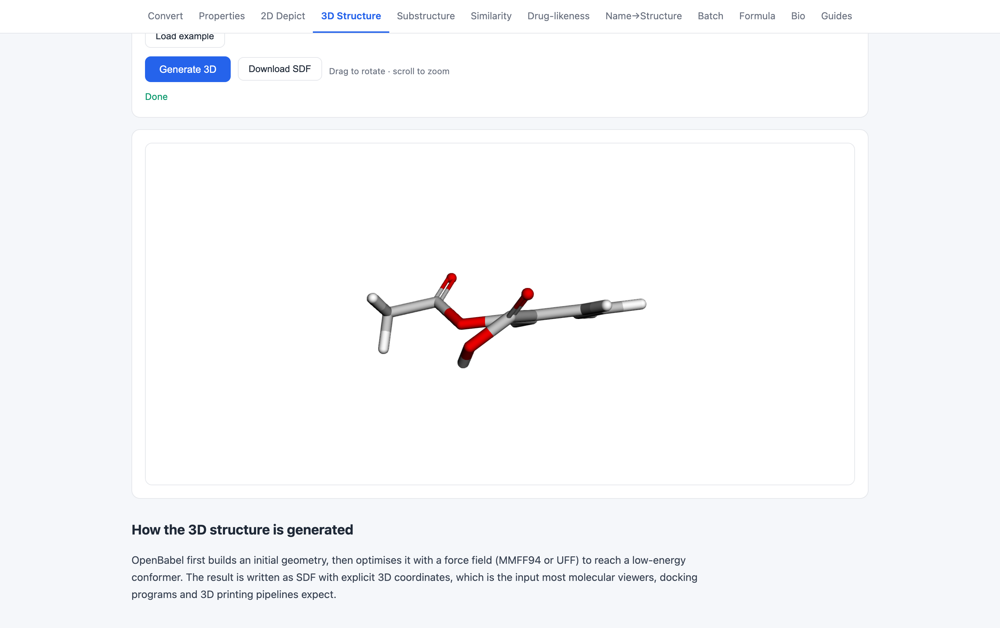
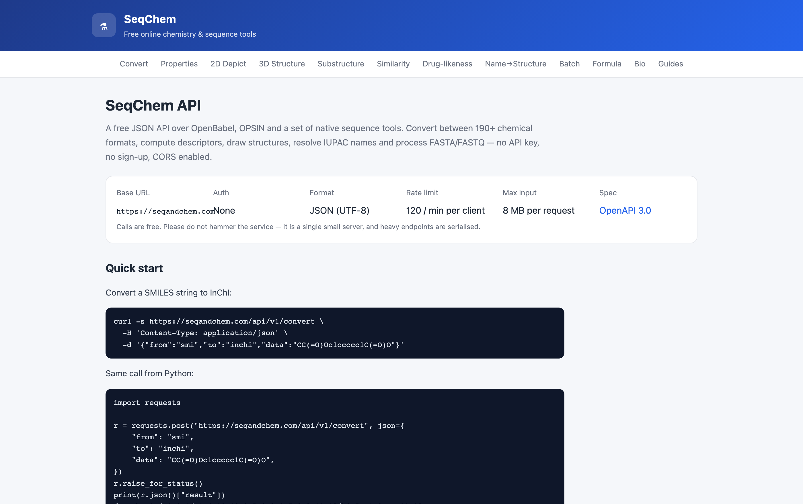

# SeqChem

[English](README.md) | [简体中文](README.zh-CN.md) | **Español** | [Português (Brasil)](README.pt-BR.md)

> Esta traducción puede estar desactualizada respecto al [README en inglés](README.md); en caso de discrepancia, prevalece la versión inglesa.

**Herramientas gratuitas en línea de química y bioinformática — <https://seqandchem.com>**

SeqChem es una aplicación web pequeña y con pocas dependencias que pone OpenBabel, OPSIN y un conjunto de utilidades de secuencias nativas detrás de una interfaz HTML sencilla y una API JSON pública. Sin cuenta, sin pago, sin medición de uso.

- Sitio web: **<https://seqandchem.com>**
- Documentación de la API: **<https://seqandchem.com/api>**
- Especificación OpenAPI: **<https://seqandchem.com/api/openapi.json>**



---

## Qué hace

### Formatos químicos
Convierte entre más de 190 formatos compatibles con OpenBabel: SMILES, InChI, InChIKey, MOL, SDF, MOL2, PDB, XYZ, CML, PNG, SVG y muchos más. Hay 26 páginas dedicadas de conversión en un clic, un convertidor genérico y un endpoint por lotes para bibliotecas completas.

| Herramienta | URL |
|---|---|
| Convertidor de formatos | `/convert` |
| Convertidor por lotes | `/batch` |
| SMILES → InChI | `/smiles-to-inchi` |
| InChI → SMILES | `/inchi-to-smiles` |
| SDF → SMILES | `/sdf-to-smiles` |
| SMILES → MOL / MOL2 / XYZ / SDF / CML | `/smiles-to-*` |
| PDB → SMILES / SDF / InChI | `/pdb-to-*` |

### Análisis de estructuras
- **Descriptores** — fórmula, masa molecular, logP, TPSA, HBD, HBA, enlaces rotables, refractividad molar, InChI, InChIKey (`/properties`)
- **Representación 2D** — renderizado de estructuras en SVG (`/depict`)
- **Conformero 3D** — optimización por campo de fuerza, renderizado en el navegador con 3Dmol.js (`/3d`)
- **Búsqueda de subestructuras** — filtrado SMARTS (`/substructure`)
- **Similitud** — Tanimoto sobre FP2/FP3/FP4/MACCS (`/similarity`)
- **Drug-likeness** — regla de los cinco de Lipinski y criterios de Veber (`/lipinski`)
- **Nombre IUPAC → estructura** — OPSIN con respaldo de PubChem (`/iupac-to-structure`)
- **Fórmula ↔ estructura** (`/formula`)

### Herramientas de secuencias
Utilidades FASTA/FASTQ en Python puro: sin servicios externos, los datos no salen del servidor.

- FASTA → FASTQ y FASTQ → FASTA (`/bio/fasta-to-fastq`, `/bio/fastq-to-fasta`)
- Contenido GC y estadísticas de secuencia (`/bio/gc-content`)
- Complemento inverso con códigos de ambigüedad IUPAC (`/bio/reverse-complement`)
- Traducción de ADN → proteína en los tres marcos de lectura (`/bio/translate`)

### Guías
Artículos explicativos que respaldan las herramientas: SMILES vs InChI vs InChIKey, la regla de los cinco de Lipinski, FASTA vs FASTQ (`/guides/`).

---

## API

Sin clave de API. JSON de entrada, JSON de salida. CORS habilitado. Uso razonable: 120 solicitudes/minuto por cliente, 300/minuto en todo el servicio; entrada máxima de 8 MB por solicitud.

```bash
curl -s https://seqandchem.com/api/v1/properties \
  -H 'Content-Type: application/json' \
  -d '{"from":"smi","data":"CC(=O)Oc1ccccc1C(=O)O"}'
```

Endpoints: `/api/v1/formats`, `/api/v1/example`, `/api/v1/convert`, `/api/v1/properties`,
`/api/v1/depict`, `/api/v1/gen3d`, `/api/v1/substructure`, `/api/v1/fingerprint`,
`/api/v1/similarity`, `/api/v1/iupac`, `/api/v1/batch`, `/api/v1/formula`, `/api/v1/bio`.

Referencia completa con ejemplos de solicitud/respuesta: <https://seqandchem.com/api>

---

## Capturas de pantalla

**Conversión de formatos** — entra SMILES, salen SDF optimizado en 3D y una vista previa interactiva.



**Representación 2D** — estructuras SVG vectoriales, listas para artículos y diapositivas.



**Conformero 3D** — generado con OpenBabel, renderizado en el navegador con 3Dmol.js.



**API pública** — documentada, versionada, con CORS y sin clave.



## Stack

- **Flask 3** + **gunicorn**, servido detrás de nginx
- **OpenBabel 3.1.1** CLI para todo el trabajo molecular (invocado como subproceso)
- **OPSIN** (Universidad de Cambridge) para analizar nombres IUPAC, vía HTTP
- **3Dmol.js** para renderizado 3D en el cliente
- **GoatCounter** para analíticas de página respetuosas con la privacidad
- Sin base de datos: la aplicación es sin estado

## Estructura del repositorio

```
app.py            Aplicación Flask: rutas, API pública, límites de tasa, metadatos SEO
presets.py        Datos de las 20 páginas de conversión de cola larga (texto único por página)
guides.py         Artículos de guía extensos
bio.py            Análisis FASTA/FASTQ y operaciones de secuencia
formula.py        Análisis de fórmulas moleculares y cálculo de pesos
templates/        Plantillas Jinja2 (diseño base, una por herramienta, docs, guías)
static/           CSS, app.js, paquete de 3Dmol, favicon
deploy/           Unidad systemd, vhost de nginx, script de monitorización
```

## Ejecución local

```bash
python3 -m venv venv
source venv/bin/activate
pip install -r requirements.txt
# además se necesita la CLI de OpenBabel, que es un paquete del sistema:
#   Debian/Ubuntu: apt install openbabel
#   macOS:         brew install open-babel
BASE_URL=http://127.0.0.1:8080 python app.py
```

La aplicación se sirve en `127.0.0.1:8080`; abre <http://127.0.0.1:8080>.

## Despliegue

`deploy/chemtools.service` y `deploy/nginx.conf` son la configuración de producción usada en
<https://seqandchem.com>: gunicorn en `127.0.0.1:8080` bajo un usuario dedicado `chemtools`, con
nginx terminando TLS.

`deploy/daily-report.sh` es la comprobación de salud operativa que envía un resumen diario
(tráfico, cobertura de rastreadores, estado del servicio, actualizaciones de seguridad) a un bot de
Feishu.

## Privacidad

No se almacena nada en el servidor. Las moléculas y secuencias se convierten en un subproceso y se
descartan. La única analítica es GoatCounter: sin cookies, sin datos personales, sin seguimiento
entre sitios.

## Créditos

- **OpenBabel** — GPL-2.0, el motor químico detrás de cada conversión y descriptor. Se usa como
  dependencia externa de línea de comandos; no está incluido en este repositorio.
- **OPSIN** — Universidad de Cambridge, análisis de nombres IUPAC, llamado por HTTP
- **3Dmol.js** — BSD-3-Clause, renderizado 3D en el navegador. Incluido en `static/3dmol-min.js` y
  sigue bajo su propia licencia BSD-3-Clause.
- **PubChem PUG REST** — respaldo para nombres comunes y búsqueda de estructuras

## Licencia

Apache License 2.0 — ver [LICENSE](LICENSE). Cubre el código fuente propio de este repositorio;
los componentes de terceros conservan sus licencias originales, como se indica arriba.
