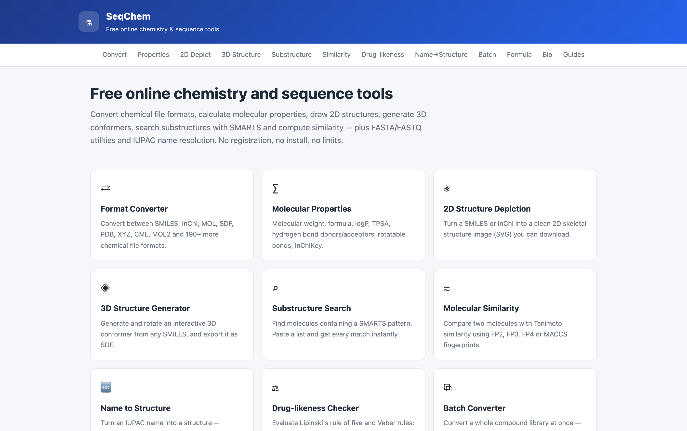
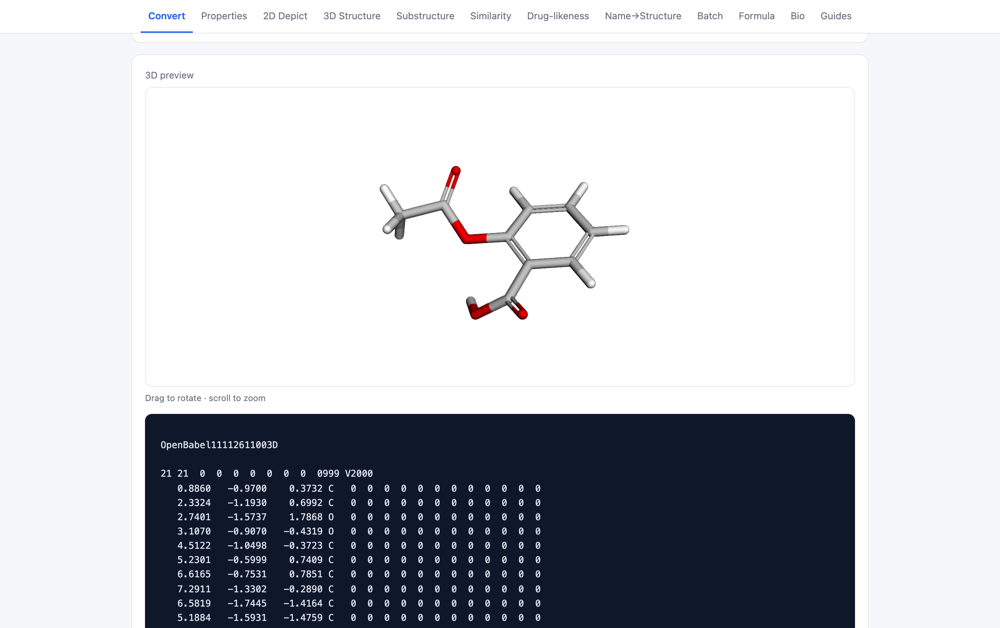
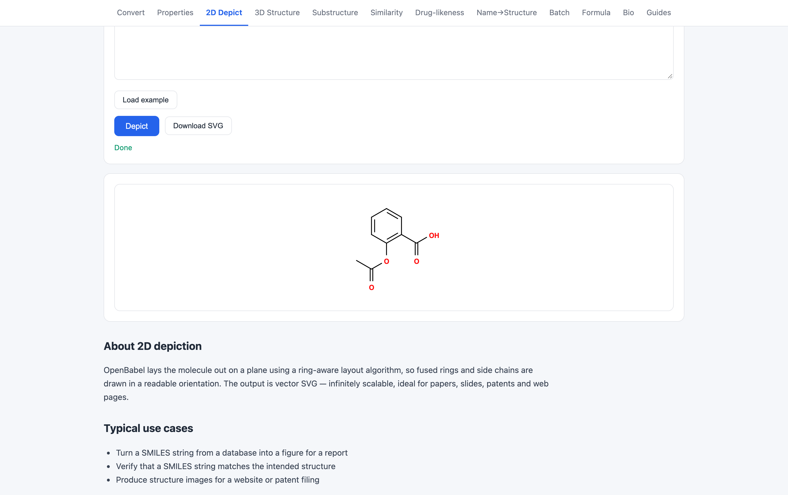
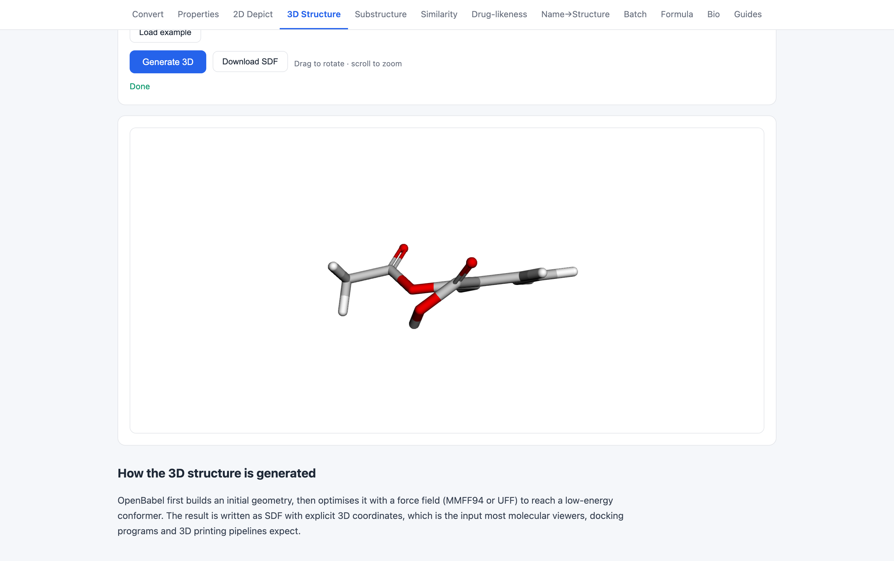
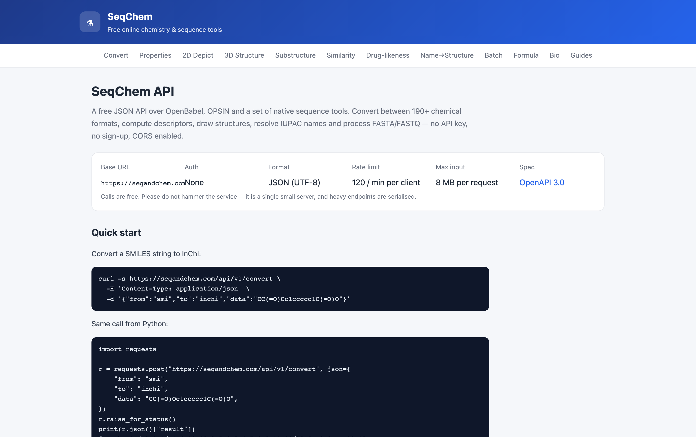

# SeqChem

[English](README.md) | [简体中文](README.zh-CN.md) | [Español](README.es.md) | **Português (Brasil)**

> Esta tradução pode estar desatualizada em relação ao [README em inglês](README.md); em caso de divergência, a versão em inglês prevalece.

**Ferramentas gratuitas online de química e bioinformática — <https://seqandchem.com>**

O SeqChem é uma aplicação web pequena e com poucas dependências que coloca o OpenBabel, o OPSIN e um conjunto de utilitários de sequências nativos por trás de uma interface HTML simples e de uma API JSON pública. Sem conta, sem paywall, sem medição de uso.

- Site: **<https://seqandchem.com>**
- Documentação da API: **<https://seqandchem.com/api>**
- Especificação OpenAPI: **<https://seqandchem.com/api/openapi.json>**



---

## O que ele faz

### Formatos químicos
Converta entre mais de 190 formatos suportados pelo OpenBabel — SMILES, InChI, InChIKey, MOL, SDF, MOL2, PDB, XYZ, CML, PNG, SVG e muitos outros. Há 26 páginas dedicadas de conversão em um clique, um conversor genérico e um endpoint em lote para bibliotecas inteiras.

| Ferramenta | URL |
|---|---|
| Conversor de formatos | `/convert` |
| Conversor em lote | `/batch` |
| SMILES → InChI | `/smiles-to-inchi` |
| InChI → SMILES | `/inchi-to-smiles` |
| SDF → SMILES | `/sdf-to-smiles` |
| SMILES → MOL / MOL2 / XYZ / SDF / CML | `/smiles-to-*` |
| PDB → SMILES / SDF / InChI | `/pdb-to-*` |

### Análise de estruturas
- **Descritores** — fórmula, massa molecular, logP, TPSA, HBD, HBA, ligações rotáveis, refratividade molar, InChI, InChIKey (`/properties`)
- **Representação 2D** — renderização de estruturas em SVG (`/depict`)
- **Conformero 3D** — otimização por campo de força, renderizada no navegador com 3Dmol.js (`/3d`)
- **Busca de subestruturas** — filtragem SMARTS (`/substructure`)
- **Similaridade** — Tanimoto sobre FP2/FP3/FP4/MACCS (`/similarity`)
- **Drug-likeness** — regra dos cinco de Lipinski e critérios de Veber (`/lipinski`)
- **Nome IUPAC → estrutura** — OPSIN com fallback do PubChem (`/iupac-to-structure`)
- **Fórmula ↔ estrutura** (`/formula`)

### Ferramentas de sequências
Utilitários FASTA/FASTQ em Python puro — sem serviços externos, os dados não saem do servidor:

- FASTA → FASTQ e FASTQ → FASTA (`/bio/fasta-to-fastq`, `/bio/fastq-to-fasta`)
- Conteúdo GC e estatísticas de sequência (`/bio/gc-content`)
- Complemento reverso com códigos de ambiguidade IUPAC (`/bio/reverse-complement`)
- Tradução de DNA → proteína nos três quadros de leitura (`/bio/translate`)

### Guias
Artigos explicativos que dão suporte às ferramentas: SMILES vs InChI vs InChIKey, a regra dos cinco de Lipinski, FASTA vs FASTQ (`/guides/`).

---

## API

Sem chave de API. JSON de entrada, JSON de saída. CORS habilitado. Uso razoável: 120 requisições/minuto por cliente, 300/minuto no serviço inteiro; entrada máxima de 8 MB por requisição.

```bash
curl -s https://seqandchem.com/api/v1/properties \
  -H 'Content-Type: application/json' \
  -d '{"from":"smi","data":"CC(=O)Oc1ccccc1C(=O)O"}'
```

Endpoints: `/api/v1/formats`, `/api/v1/example`, `/api/v1/convert`, `/api/v1/properties`,
`/api/v1/depict`, `/api/v1/gen3d`, `/api/v1/substructure`, `/api/v1/fingerprint`,
`/api/v1/similarity`, `/api/v1/iupac`, `/api/v1/batch`, `/api/v1/formula`, `/api/v1/bio`.

Referência completa com exemplos de requisição/resposta: <https://seqandchem.com/api>

---

## Capturas de tela

**Conversão de formatos** — entra SMILES, saem SDF otimizado em 3D e uma prévia interativa.



**Representação 2D** — estruturas SVG vetoriais, prontas para artigos e slides.



**Conformero 3D** — gerado com OpenBabel, renderizado no navegador com 3Dmol.js.



**API pública** — documentada, versionada, com CORS e sem chave.



## Stack

- **Flask 3** + **gunicorn**, servido atrás do nginx
- **OpenBabel 3.1.1** CLI para todo o trabalho molecular (invocado como subprocesso)
- **OPSIN** (Universidade de Cambridge) para análise de nomes IUPAC, via HTTP
- **3Dmol.js** para renderização 3D no cliente
- **GoatCounter** para análises de página amigáveis à privacidade
- Sem banco de dados — a aplicação é stateless

## Estrutura do repositório

```
app.py            Aplicação Flask: rotas, API pública, limite de requisições, metadados de SEO
presets.py        Dados das 20 páginas de conversão de cauda longa (texto único por página)
guides.py         Artigos de guia extensos
bio.py            Análise FASTA/FASTQ e operações de sequência
formula.py        Análise de fórmulas moleculares e cálculo de massas
templates/        Templates Jinja2 (layout base, um por ferramenta, docs, guias)
static/           CSS, app.js, pacote 3Dmol, favicon
deploy/           Unidade systemd, vhost do nginx, script de monitoramento
```

## Execução local

```bash
python3 -m venv venv
source venv/bin/activate
pip install -r requirements.txt
# além disso, é necessário o CLI do OpenBabel, que é um pacote do sistema:
#   Debian/Ubuntu: apt install openbabel
#   macOS:         brew install open-babel
BASE_URL=http://127.0.0.1:8080 python app.py
```

A aplicação é servida em `127.0.0.1:8080`; abra <http://127.0.0.1:8080>.

## Implantação

`deploy/chemtools.service` e `deploy/nginx.conf` são a configuração de produção usada em
<https://seqandchem.com>: gunicorn em `127.0.0.1:8080` sob um usuário dedicado `chemtools`, com
o nginx terminando o TLS.

`deploy/daily-report.sh` é a verificação de saúde operacional que envia um resumo diário
(tráfego, cobertura de rastreadores, estado dos serviços, atualizações de segurança) para um bot do
Feishu.

## Privacidade

Nada é armazenado no servidor. Moléculas e sequências são convertidas em um subprocesso e
descartadas. A única análise é o GoatCounter — sem cookies, sem dados pessoais, sem rastreamento
entre sites.

## Créditos

- **OpenBabel** — GPL-2.0, o motor químico por trás de cada conversão e descritor. Usado como
  dependência externa de linha de comando; não é incluído neste repositório.
- **OPSIN** — Universidade de Cambridge, análise de nomes IUPAC, chamado via HTTP
- **3Dmol.js** — BSD-3-Clause, renderização 3D no navegador. Incluído em `static/3dmol-min.js` e
  permanece sob sua própria licença BSD-3-Clause.
- **PubChem PUG REST** — fallback para nomes comuns e busca de estruturas

## Licença

Apache License 2.0 — consulte [LICENSE](LICENSE). Cobre o código-fonte próprio deste repositório;
componentes de terceiros mantêm suas licenças originais, conforme indicado acima.
