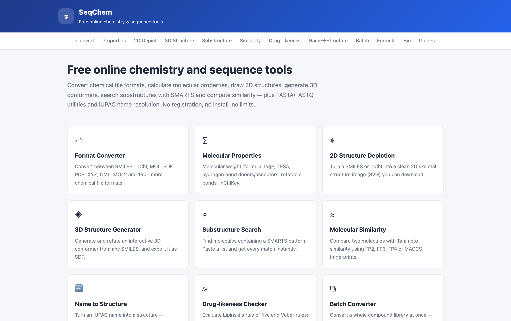
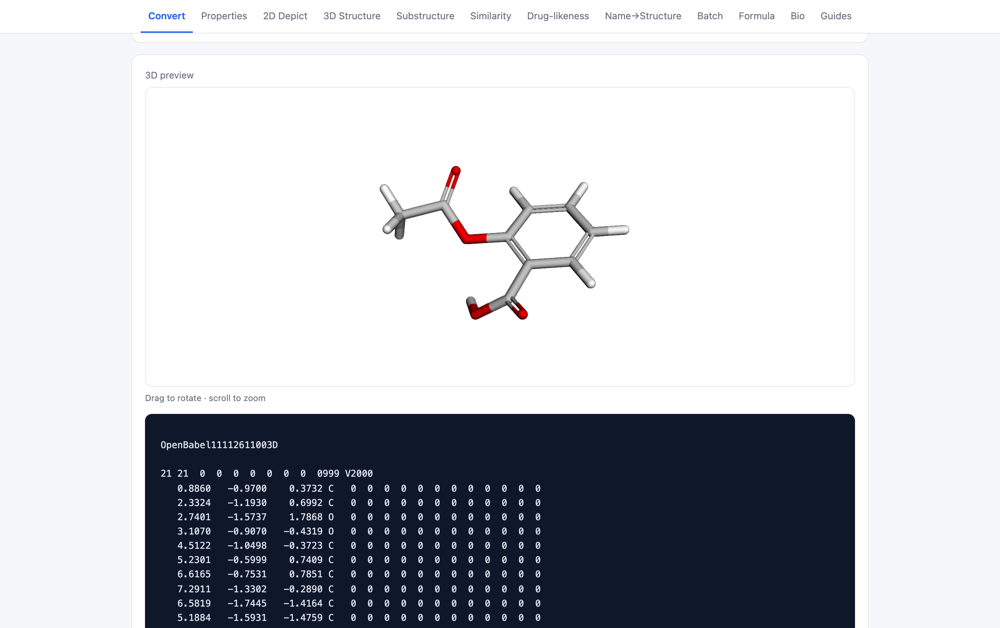
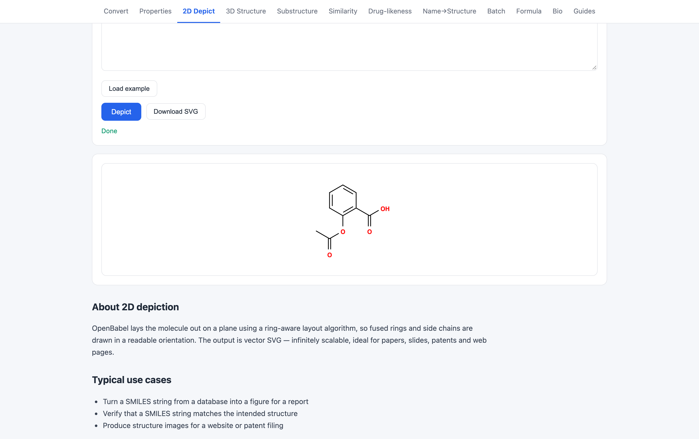
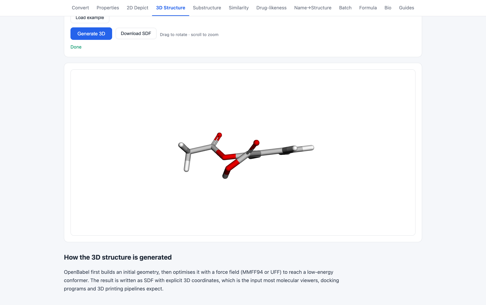
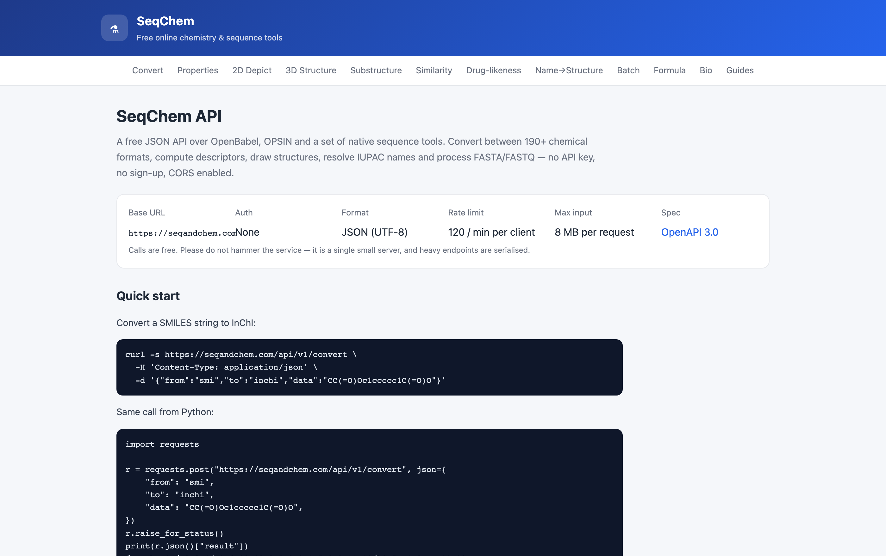

# SeqChem

[English](README.md) | **简体中文** | [Español](README.es.md) | [Português (Brasil)](README.pt-BR.md)

> 本翻译可能滞后于英文版；如有差异，以 [英文 README](README.md) 为准。

**免费在线化学与生物信息学工具 — <https://seqandchem.com>**

SeqChem 是一个轻量、依赖少的 Web 应用，将 OpenBabel、OPSIN 和一组原生序列工具封装在简洁的 HTML 界面和公开 JSON API 之后。无需账号、无付费墙、无使用量限制。

- 网站：**<https://seqandchem.com>**
- API 文档：**<https://seqandchem.com/api>**
- OpenAPI 规范：**<https://seqandchem.com/api/openapi.json>**



---

## 功能

### 化学格式
在 OpenBabel 支持的 190+ 种格式之间转换——SMILES、InChI、InChIKey、MOL、SDF、MOL2、PDB、XYZ、CML、PNG、SVG 等。提供 26 个专用的一键转换页面、一个通用转换器，以及面向整库的批量接口。

| 工具 | URL |
|---|---|
| 格式转换器 | `/convert` |
| 批量转换器 | `/batch` |
| SMILES → InChI | `/smiles-to-inchi` |
| InChI → SMILES | `/inchi-to-smiles` |
| SDF → SMILES | `/sdf-to-smiles` |
| SMILES → MOL / MOL2 / XYZ / SDF / CML | `/smiles-to-*` |
| PDB → SMILES / SDF / InChI | `/pdb-to-*` |

### 结构分析
- **分子描述符** — 分子式、分子量、logP、TPSA、HBD、HBA、可旋转键、摩尔折射率、InChI、InChIKey（`/properties`）
- **2D 结构图** — SVG 结构渲染（`/depict`）
- **3D 构象** — 力场优化，使用 3Dmol.js 在浏览器内渲染（`/3d`）
- **子结构搜索** — SMARTS 过滤（`/substructure`）
- **相似度** — 基于 FP2/FP3/FP4/MACCS 的 Tanimoto 系数（`/similarity`）
- **类药性** — Lipinski 五规则及 Veber 标准（`/lipinski`）
- **IUPAC 名称 → 结构** — OPSIN，PubChem 兜底（`/iupac-to-structure`）
- **分子式 ↔ 结构**（`/formula`）

### 序列工具
纯 Python 实现的 FASTA/FASTQ 工具——不依赖外部服务，数据不会离开服务器：

- FASTA → FASTQ 与 FASTQ → FASTA（`/bio/fasta-to-fastq`、`/bio/fastq-to-fasta`）
- GC 含量与序列统计（`/bio/gc-content`）
- 支持 IUPAC 简并碱基的反向互补（`/bio/reverse-complement`）
- 三个读码框的 DNA → 蛋白质翻译（`/bio/translate`）

### 指南
支撑这些工具的长文说明：SMILES vs InChI vs InChIKey、Lipinski 五规则、FASTA vs FASTQ（`/guides/`）。

---

## API

无需 API key。JSON 输入、JSON 输出。已启用 CORS。合理使用限制：每客户端 120 请求/分钟，全服务 300 请求/分钟；单次请求最大输入 8 MB。

```bash
curl -s https://seqandchem.com/api/v1/properties \
  -H 'Content-Type: application/json' \
  -d '{"from":"smi","data":"CC(=O)Oc1ccccc1C(=O)O"}'
```

接口：`/api/v1/formats`、`/api/v1/example`、`/api/v1/convert`、`/api/v1/properties`、
`/api/v1/depict`、`/api/v1/gen3d`、`/api/v1/substructure`、`/api/v1/fingerprint`、
`/api/v1/similarity`、`/api/v1/iupac`、`/api/v1/batch`、`/api/v1/formula`、`/api/v1/bio`。

完整参考（含请求/响应示例）：<https://seqandchem.com/api>

---

## 截图

**格式转换** — 输入 SMILES，输出经 3D 优化的 SDF 和交互式预览。



**2D 结构图** — 矢量 SVG 结构，可直接用于论文和幻灯片。



**3D 构象** — 由 OpenBabel 生成，使用 3Dmol.js 在浏览器中渲染。



**公开 API** — 有文档、有版本、支持 CORS、无需密钥。



## 技术栈

- **Flask 3** + **gunicorn**，由 nginx 反向代理
- **OpenBabel 3.1.1** CLI 负责所有分子处理（以子进程调用）
- **OPSIN**（剑桥大学）通过 HTTP 解析 IUPAC 名称
- **3Dmol.js** 负责客户端 3D 渲染
- **GoatCounter** 提供隐私友好的页面统计
- 无数据库——应用无状态

## 仓库结构

```
app.py            Flask 应用：路由、公开 API、限流、SEO 元数据
presets.py        20 个长尾转换页面的数据（每页独立文案）
guides.py         长篇指南文章
bio.py            FASTA/FASTQ 解析与序列操作
formula.py        分子式解析与分子量计算
templates/        Jinja2 模板（基础布局、每个工具一页、文档、指南）
static/           CSS、app.js、3Dmol 打包文件、favicon
deploy/           systemd unit、nginx vhost、监控脚本
```

## 本地运行

```bash
python3 -m venv venv
source venv/bin/activate
pip install -r requirements.txt
# 另外需要 OpenBabel CLI（系统包）：
#   Debian/Ubuntu: apt install openbabel
#   macOS:         brew install open-babel
BASE_URL=http://127.0.0.1:8080 python app.py
```

应用监听 `127.0.0.1:8080`；打开 <http://127.0.0.1:8080>。

## 部署

`deploy/chemtools.service` 和 `deploy/nginx.conf` 是 <https://seqandchem.com> 使用的生产配置：gunicorn 以专用 `chemtools` 用户运行在 `127.0.0.1:8080`，由 nginx 终止 TLS。

`deploy/daily-report.sh` 是运维健康检查脚本，每天把摘要（流量、爬虫覆盖、服务状态、安全更新）推送到飞书机器人。

## 隐私

服务器端不存储任何内容。分子和序列在子进程中转换后即丢弃。唯一统计工具是 GoatCounter——无 Cookie、不收集个人数据、不做跨站跟踪。

## 致谢

- **OpenBabel** — GPL-2.0，所有转换和描述符背后的化学引擎。作为外部命令行依赖使用，未打包进本仓库。
- **OPSIN** — 剑桥大学，IUPAC 名称解析，通过 HTTP 调用
- **3Dmol.js** — BSD-3-Clause，浏览器内 3D 渲染。打包在 `static/3dmol-min.js`，仍遵循其 BSD-3-Clause 许可证。
- **PubChem PUG REST** — 用于俗名和结构查询的兜底服务

## 许可证

Apache License 2.0 — 见 [LICENSE](LICENSE)。该许可覆盖本仓库自有源代码；第三方组件保留其各自许可证，如上所述。
